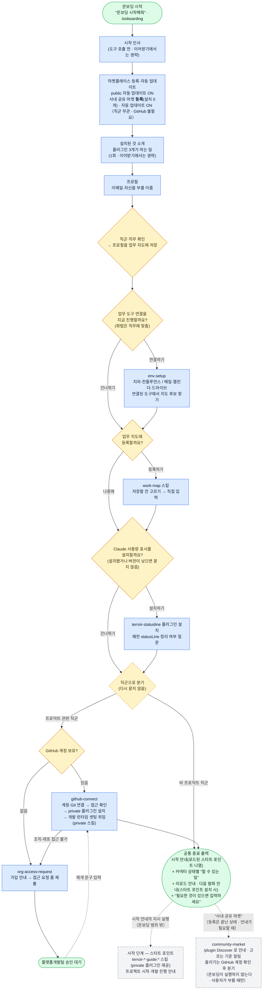

# terroir-onboarding

> Terroir를 처음 시작하는 사람을 위한 **온보딩 진입점 플러그인**.
> 업무 도구·GitHub 연결, 사내 플러그인 설치, 업무 지도(work-map) 등록, Claude 사용량 표시 설치까지 안내한다.
> 사전 인증 없이 설치할 수 있다.

## 설치

```
/plugin marketplace add VntgCorp/terroir-claude-plugin-public
/plugin install terroir-onboarding@terroir-claude-plugin-public
```

## 자동 업데이트 설정

`/onboarding`을 실행하면 가장 먼저 `terroir-claude-plugin-public`의 사용자 전역 설정을
`autoUpdate: true`로 바꾸고 결과를 안내한다. 프로덕트 직군이 private 플러그인 설치까지
진행하면 `terroir-claude-plugin`에도 같은 설정을 적용한다. 기존 설정과 마켓플레이스 채널은
보존하며, 설정 실패가 나머지 온보딩을 막지는 않는다.

## 사용

```
온보딩 시작해줘
```

또는 `/onboarding`.

## 업무 지도(work-map)

자주 쓰는 곳을 사용자 폴더의 파일 하나에 모아 두고, 세션마다 Claude 가 그 목차를 먼저 알고 시작하게 한다.

- **파일:** `~/.claude/terroir/work-map.md` (`CLAUDE_CONFIG_DIR` 가 있으면 그 아래 `terroir/work-map.md`). 작업 중인 레포 밖이라 커밋되지 않는다.
- **기본 칸:** 프로필(이메일·자신을 부를 이름·직무 분류·직무) · 지라·컨플루언스 프로젝트 · 자주 쓰는 채널 · 자주 대화하는 사람 · GitHub 프로젝트 · 드라이브 주소 · 규칙 위치. 사용자가 요청하면 칸을 더 만든다.
- **새 세션에서:** Claude 가 지도의 칸 제목과 "언제 읽나"만 먼저 보고, 그 칸에 해당하는 일을 할 때 파일을 열어 값을 읽는다.
- **만들고 고치기:** `/work-map`, 또는 "업무 정보 등록해줘", "지도 고쳐줘", "이것도 지도에 넣어줘". 처음 등록할 때는 저장할 칸을 먼저 고르고, 고른 칸만 입력한다. 일하다 지도에 없는 곳을 알려 주면 Claude 가 저장할지 한 번 묻는다.
- **도구에서 후보 찾기:** 업무 도구 연결 안내에서 연결된 도구(지라·컨플루언스, 메일, 드라이브)로 후보를 찾아 고를 수 있다.
- **방금 연결한 도구:** 온보딩이나 업무 도구 연결 안내를 따라 도구를 새로 연결한 세션에서는 그 도구로 후보를 찾을 수 없다. 다음 세션에 Claude 가 그 도구로 지도 후보를 찾을지 한 번 묻는다.

지도에는 어디에 무엇이 있는지(주소·ID·사람)만 둔다. 일하는 방식·판단·피드백은 Claude Code 메모리에 남긴다.

## 떼루아 레슨

떼루아가 무엇이고 무엇을 해 주는지 물으면 Claude 가 레슨을 근거로 답한다.

- **새 세션에서:** 레슨 목차와 원본 경로만 올라간다. 본문은 질문이 오면 그 레슨만 읽는다.
- **직접 부르기:** `/lessons` — 레슨 목록을 보거나 레슨을 근거로 답을 받는다.
- **갱신:** **이 레포는 public 이다** — 레슨을 더하거나 고칠 때는 공개해도 되는 내용인지 먼저 확인한다. 레슨이 바뀌면 `plugin.json` 의 `version` 과 `CHANGELOG.md` 를 함께 올린다.

## Claude 사용량 표시(statusline)

온보딩 중 Claude 사용량 표시 플러그인 [`terroir-statusline`](../terroir-statusline) 을 설치할지 한 번 묻는다. 표시 내용과 설치 조건은 그 플러그인의 README 를 따른다.

- **묻지 않는 경우:** 이미 설치돼 있거나 Claude Code 가 2.1.287 보다 낮으면 묻지 않고 한 줄로 알린다.
- **예전 표시줄 정리:** 설치한 뒤 `settings.json` 의 `statusLine` 이 예전에 공유한 스크립트(`statusline-command.sh`·`.ps1`)를 가리키면 삭제할지 묻는다. 직접 만든 표시줄은 건드리지 않는다.
- **건너뛴 경우:** `claude plugin install terroir-statusline@terroir-claude-plugin-public --scope user` 로 따로 설치한다.

## 온보딩 플로우

스킬 간 분기 수준의 전체 흐름이다. 각 스킬의 내부 절차는 해당 SKILL.md가 유일한 진실이다.
시작 인사를 도구 호출보다 먼저 출력하고, Public 자동 업데이트 설정은 모든 분기보다 먼저 실행하고, 그 다음 설치된 것 소개를 1회 출력한다. 온보딩을 완주한 경로의 종착점은
`onboarding`의 공통 종료 출력이다. 조직 접근 승인이 필요한 경로는 종료 출력 없이 대기 상태로
멈췄다가, 승인 후 재개 문구를 받아 `github-connect`로 이어진다.

종료 출력은 두 블록의 조합이다 — 시작 안내(세션에 로드된 스타트 포인트 `terroir-*-guide:*` 스킬 나열, 없으면 설치 여부와 직무에 따라 자리를 비우거나 안내 한 줄로 대체) + 커넥터 상태별 "할 수 있는 일"(연결/미연결 런타임 확인). 스타트 포인트가 설치된 경로에서는 여기에 마무리 두 줄(`/reload-plugins` 안내 + 리로드 뒤 물어볼 문장)이 따라붙는다. 스타트 포인트는 private 플러그인이 제공하므로, 추가돼도 이 플러그인의 문서는 바뀌지 않는다. 시작 단계(프로젝트 시작·개발 진행 안내)는 온보딩 범위 밖이다.


